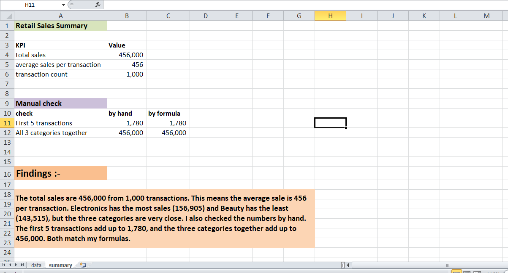

# Basic Sales Summary (Excel)

## Overview
A summary sheet with 3 KPIs built from the Retail Sales Dataset (1,000 transactions).

## Workbook structure
- Data: original dataset, not changed
- Summary: 3 KPIs, manual verification and findings

## KPIs
- Total Sales: 456,000 (SUM)
- Average Sales per Transaction: 456.00 (AVERAGE)
- Transaction Count: 1,000 (COUNTA)

## Manual verification
- The first 5 transactions added by hand (1,780) match =SUM of the same rows
- Beauty (143,515) + Clothing (155,580) + Electronics (156,905) = 456,000,
  which matches Total Sales

## Findings
Electronics has the highest sales and Beauty the lowest, but the three categories
are close. The average transaction is 456.

## Tools Used
Microsoft Excel (SUM, AVERAGE, COUNTA, IF)

## Dataset
Retail Sales Dataset (Kaggle, synthetic data)

## Screenshot

